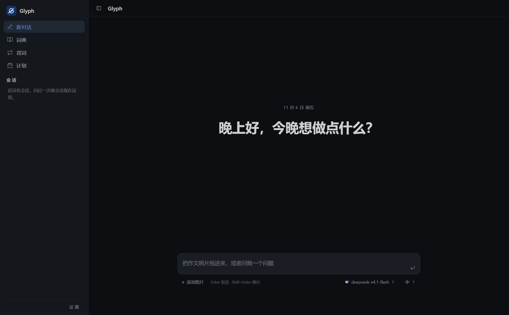
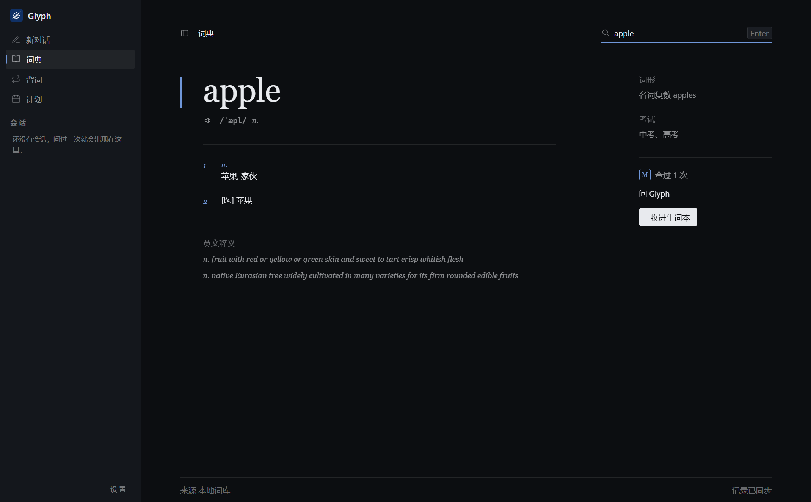
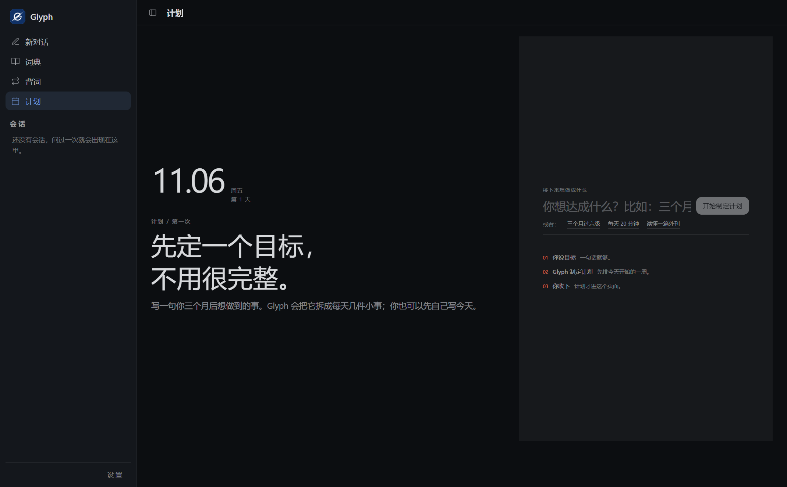
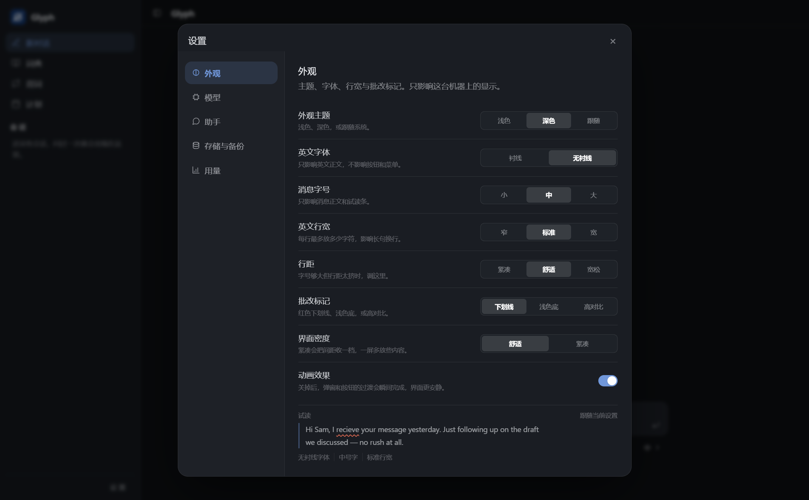

# Glyph

[](https://github.com/woaichidabing/glyph/actions/workflows/ci.yml)
[](LICENSE)

本地运行的英语学习 Agent：批改、查词、背词、计划、长期记忆，全部在自己的电脑上跑。

Glyph 用「工具循环」驱动：模型自己决定调哪个工具（批改、查词、OCR、记忆、计划……），
业务能力都是可插拔的工具，运行时本身不写死任何批改流程。



| 词典 | 计划 |
|---|---|
|  |  |



## 功能

- **对话批改**：发英文句子或作文，得到语法/拼写问题、逐条中文讲解、修改建议；支持图片转写后批改。
- **词典**：本地词库查音标、释义、例句、词形；查词记录会留痕。
- **背词**：词书、一遍过判卷、错题本、今日小结。
- **计划**：定目标、排周节奏、每天任务；没做完自动顺延。
- **长期记忆**：自动记住偏好与错题；设置里可一键清空，回收站可永久清理。
- **桌面端**：Electron 窗口，关窗进托盘；数据默认在 `文档/Glyph`。

## 技术栈

- 后端：Python 3.12 + FastAPI + 自研 Agent 运行时（`src/glyph/`）
- 前端：React 18 + TypeScript + Vite + Zustand（`web-desktop2/`）
- 桌面：Electron + electron-builder（NSIS）

## 快速开始

### 1. 后端

```bash
python -m venv .venv
.venv\Scripts\python -m pip install -U pip        # Windows
# source .venv/bin/activate && pip install -U pip  # macOS/Linux
.venv\Scripts\python -m pip install -e ".[dev,qwen,grade,web]"
.venv\Scripts\python -m uvicorn web.server:app --host 127.0.0.1 --port 8080
```

### 2. 前端

```bash
cd web-desktop2
npm install
npm run dev        # http://localhost:5174，/api 代理到 8080
```

### 3. 桌面端

```bash
cd web-desktop2
npm run desktop    # 会自己拉起后端
```

### 4. 配置模型

打开 设置 → 模型，添加一个 OpenAI 兼容的模型来源并填 API Key；
也可以复制 `.env.example` 为 `.env`，填入 `DASHSCOPE_API_KEY`。

## 词典数据

`data/dict.db` 已随仓库提供，开箱即用。

数据来自 [ECDICT](https://github.com/skywind3000/ECDICT)（MIT，Copyright (c) 2025 Linwei），
许可证与说明见 [data/README.md](data/README.md)。

需要重新构建时（需要 ECDICT 的 CSV）：

```bash
python scripts/build_dict_db.py
```

## 测试

```bash
# 后端（离线，不联网）
.venv\Scripts\python -m pytest -q

# 前端
cd web-desktop2
npm test
npm run typecheck
```

真模型测试需要 Key，并显式开启：

```bash
.venv\Scripts\python -m pytest -o addopts="" -m integration -q
```

## 打包 Windows 安装包

```bash
# 1) 先打包后端 exe（PyInstaller，输出 dist/glyph-backend.exe）
.\scripts\build-backend.ps1

# 2) 再打安装包（electron-builder，输出 web-desktop2/release/Glyph-Setup-*.exe）
cd web-desktop2
npm run dist:win
```

## 数据与隐私

- 默认数据目录：`文档/Glyph`（会话、计划、词书、记忆、模型配置）；
- 没有账号、没有遥测；只有你主动发消息时，内容才会发给你自己配置的模型服务商；
- 详见 [docs/隐私说明.md](docs/隐私说明.md)。

## 已知限制

- Windows 安装包暂未做代码签名，首次安装会提示「未知发布者」；
- 暂不支持自动更新。

## 许可证

MIT。第三方数据与字体：

- 词典数据来自 [ECDICT](https://github.com/skywind3000/ECDICT)（MIT）；
- 字体 Montserrat，SIL Open Font License 1.1（见 `web-desktop2/src/assets/fonts/Montserrat-OFL.txt`）。
